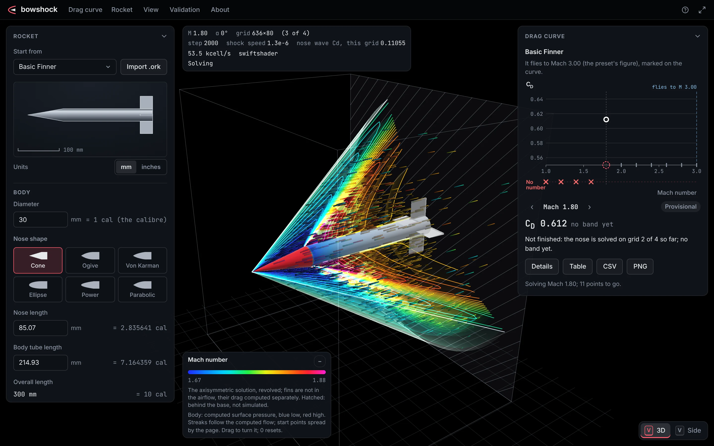

# bowshock

bowshock is a compressible-flow (CFD) solver that runs in your web browser,
on your own GPU, with nothing to install, and computes the supersonic drag
of model rockets, for amateur and student rocketry teams who fly beyond
Mach 1. Every drag number it shows says how far it has been checked, and
where its methods do not reach, it refuses, with the reason, instead of
guessing.

**Try it in your browser: <https://ahroonsanthosh.github.io/bowshock/>**
(needs WebGPU: a recent Chrome or Edge, for example). Early development:
nothing here should be used for flight decisions yet.



_The live flow page, as the browser took it: the Basic Finner's nose cone
and body at Mach 2, schlieren above the axis, Mach number below. On one
grid (20 cells across, on software WebGPU) there is no error band, so the
page marks the wave drag Not verified; a band needs four grids, to 160
cells across._

[What works today](#what-works-today) ·
[How accuracy is earned](#how-accuracy-is-earned) ·
[Run it locally](#run-it-locally) · [Contributing](#contributing) ·
[License: AGPL-3.0-or-later](#license)

## What works today

| Capability                                                                                                                                                                                           | Status today                                                                                                                                                                                                                                                           | Record                                                                                       |
| ---------------------------------------------------------------------------------------------------------------------------------------------------------------------------------------------------- | ---------------------------------------------------------------------------------------------------------------------------------------------------------------------------------------------------------------------------------------------------------------------- | -------------------------------------------------------------------------------------------- |
| **Nose wave drag**: the inviscid forebody pressure drag of cones, ogives, parabolic and ellipsoid noses, Mach 1.2 to 5 ([drag page](https://ahroonsanthosh.github.io/bowshock/demos/nose-drag.html)) | **Verified**: an error band measured from nested grids (on the sharp noses compared with exact or converged references, every band contained the error). **Not verified** where no band can be measured. **Refused**, with the reason, where the method does not reach | [0005](docs/design/0005-solution-verification.md), [0006](docs/design/0006-shock-fitting.md) |
| **Live flow**: that solve, drawn as it converges ([flow page](https://ahroonsanthosh.github.io/bowshock/demos/flow-view.html))                                                                       | The same solve and labels, drawn from the solver's own value in each cell                                                                                                                                                                                              | [0012](docs/design/0012-interface.md)                                                        |
| **Solver checks**: shock tube, oblique shocks and expansions, cones                                                                                                                                  | **Verified** against exact solutions                                                                                                                                                                                                                                   | [0003](docs/design/0003-2d-solver.md)                                                        |
| **Skin friction**                                                                                                                                                                                    | **Validated on component data**: measured friction 0.88 to 1.19 times the model in all 23 wind-tunnel and flight comparisons                                                                                                                                           | [0007](docs/design/0007-skin-friction.md)                                                    |
| **Fin drag**                                                                                                                                                                                         | **Estimated on component data** (measured 1.01 to 1.59 times the model on the ARCAS fin increments), tested only in the total                                                                                                                                          | [0009](docs/design/0009-fin-wave-drag.md)                                                    |
| **Base drag**, and the fins' edges                                                                                                                                                                   | **Estimated on component data**, tested only in the total; the fins-on-base factor **bounded, not measured** above Mach 2.56, where its free-flight data end, and **refused** for swept fins until it is rebuilt; the fins' edges **an analogy, not a measurement**    | [0010](docs/design/0010-base-drag-and-total.md)                                              |
| **Total drag** of a nose, body and fins ([drag page](https://ahroonsanthosh.github.io/bowshock/demos/nose-drag.html))                                                                                | **An estimate, not validated**, everywhere today: the Basic Finner's validated claim is suspended ([below](#the-basic-finners-total-drag)). **Refused**, with every reason, where a component's method does not reach: today, almost every realistic rocket            | [0011](docs/design/0011-total-drag-on-the-page.md), [0014](docs/design/0014-refusals.md)     |
| **Mach 1 to 1.2**                                                                                                                                                                                    | A measured prototype, **not served**                                                                                                                                                                                                                                   | [0013](docs/design/0013-transonic.md)                                                        |
| **Viscous flow (RANS)**; C<sub>D</sub> against Mach number, exported                                                                                                                                 | **Not built**: [planned](#planned-not-yet-built)                                                                                                                                                                                                                       | [0002](docs/design/0002-architecture.md)                                                     |
| **Angle of attack, roll, the motor plume**                                                                                                                                                           | **Out of scope** until the core is validated                                                                                                                                                                                                                           | [0002](docs/design/0002-architecture.md)                                                     |

The statuses, in the project's own words: **verified**, an error band
measured from the grids; **validated** or **estimated on component data**, a
component's band set from measurements of that component; **an estimate,
not validated**, a total that no held-back test has confirmed as it now
stands; **bounded, not measured**, a component no measurement covers (today
the fins-on-base factor above Mach 2.56): the midpoint of two bounds, its
band the whole gap between them ([0014](docs/design/0014-refusals.md)
section 10.2); **refused**, every reason and no number. On 2000 modelled
rockets like those amateur and student teams fly beyond Mach 1, the drag
page today gives a total for at most 0.2% in any Mach band, and the nose
wave drag alone for 23.9% to 24.6% at Mach 1.2 to 3.0
([0014](docs/design/0014-refusals.md) section 10.7;
[the run](docs/research/refusals/out/2026-10-21-swept-at-base/impact.out)).

### The Basic Finner's total drag

The total drag has had one hold-out test: the Basic Finner, a reference
projectile (a 20 degree cone on a cylinder, 10 calibers long, with four
fins at the base), in free flight, 11 shots at Mach 1.80 to 2.97 that set
no band. It passed at every shot: measured drag within -7.7% to +4.5% of
the model, inside tolerances that are wide (-19.5% to -26.2% below,
+23.1% to +27.4% above) ([0010](docs/design/0010-base-drag-and-total.md)
section 4.2). Then one term that test checked, the fins' effect on base
pressure, was found to rest, above Mach 2.15, on one of Love's predictions
in TN 3819 fig. 35 instead of the figure's free-flight curve, which ends
at Mach 2.56. The curve was identified from the report and read twice,
and the factor was corrected to it after the test's results were known;
above the curve's end it is bounded, not measured. The correction moved
the total by up to 3% above Mach 2.15 and by at most 0.24% inside the
class the test had opened (Mach 1.8 to 2.15), but a term changed after a
test is not validated by it ([0008](docs/design/0008-total-drag.md)
section 6.1), so by the owner's decision of 2026-10-21 the validated claim
is suspended: **no total is validated today.** The class is kept for the
next registered test, BRL Report 934's Basic Finner rounds in its range A
(Mach 1.5 to 2.47), run once as registered, which covers the class's Mach
range at BRL's own Reynolds numbers and sharp leading edges (both outside
the class; [0014](docs/design/0014-refusals.md) section 10.6). If it
passes, the class is validated over what that range supports; if it
fails, the claim is withdrawn
([0010](docs/design/0010-base-drag-and-total.md) section 11.7;
[0014](docs/design/0014-refusals.md) section 10).

## How accuracy is earned

- **Registered before it is run.** The data sets that test the total are
  held back, and how each is run is fixed and committed before any model
  is run on it: its Mach ranges and, for BRL Report 934, every input it
  does not state. Each range is run once, and its result is recorded
  whatever it is ([0014](docs/design/0014-refusals.md) section 10). A data
  set that sets a band never tests it, and a failed test refuses the
  configuration instead of widening a band
  ([0008](docs/design/0008-total-drag.md) section 6.1).
- **Every figure read twice.** Each figure behind a band or a test is read
  twice, independently, before it is used; where the readings differ by
  more than their reading error, both are kept and the one that widens the
  band is used ([0008](docs/design/0008-total-drag.md), its reading rule).
- **Independent reviews.** The total-drag work has had five recorded rounds
  of independent audit: two of the method and its sources, two of second
  readings, and one that re-implemented the total from the records
  ([audits](docs/research/total-drag/audit/)). The interface had an
  independent review, and a second review of its fixes
  ([0012](docs/design/0012-interface.md)).
- **Refusals over guesses.** Where a method has no measured band for a
  case, the page refuses the number, with every reason, instead of
  estimating it; a wave drag without a band is shown only marked not
  verified, and the total refuses it
  ([0014](docs/design/0014-refusals.md)).
- **Bands from measurement.** Every wave drag's band is measured from
  nested grids of that case
  ([0005](docs/design/0005-solution-verification.md)); every component's
  band from data, its sources listed with how far each has been checked
  ([sources](docs/validation/sources.md)).

## Run it locally

Requires Node.js 22.12 or newer.

```sh
npm ci            # install the dependencies
npm run dev       # serve the pages; open the address Vite prints
npm run check     # formatting, lint, type check and the unit tests
npm run test:gpu  # the WebGPU tests, in headless Chromium
npm run build     # a static site in dist/, which works from any path
```

`npm run dev` prints the address to open (usually http://localhost:5173/),
from which you pick a page. The pages need a browser with WebGPU; the ramp
and the shock tube fall back to the CPU without it. `npm run test:gpu`
needs Chromium
(`npx playwright install chromium`, or `CHROMIUM_PATH`); without a hardware
GPU it runs on SwiftShader, which is slow but runs the same shaders.

## Contributing

Correctness comes before features. In short: published methods only,
implemented from scratch and cited beside the code; no FluidX3D code; no
number from a source you have not checked; every change tested, and every
bug fix with a test that failed before it. The rules, and how to test GPU
code, are in [CONTRIBUTING.md](CONTRIBUTING.md).

## The pages

- **Nose wave drag and total drag**
  ([open](https://ahroonsanthosh.github.io/bowshock/demos/nose-drag.html)):
  the inviscid forebody pressure (wave) drag coefficient of a cone, tangent
  or secant ogive, parabolic-series or ellipsoid nose and its body, refined
  on nested grids on your GPU and reported with its measured error band, or
  as not verified; and, from that solve, the rocket's total drag with fins
  and base at the altitude and diameter you give, with its bands, its
  components and their labels: an estimate, not validated, with the reasons
  (inside the Basic Finner's class too, while its validated claim is
  suspended), or refused with the reasons.
- **Live flow**
  ([open](https://ahroonsanthosh.github.io/bowshock/demos/flow-view.html)):
  the flow around the Basic Finner's nose cone and body, solved on your GPU
  as the drag page solves it and drawn from the GPU's memory as it
  converges: schlieren, Mach number, pressure coefficient or density,
  mirrored about the axis, with pan, zoom and a split view.
- **Supersonic ramp**
  ([open](https://ahroonsanthosh.github.io/bowshock/demos/supersonic-ramp.html)):
  oblique shocks and Prandtl-Meyer expansion fans, solved live on your GPU
  and drawn as numerical schlieren or colour-mapped fields, with the ramp
  pressure compared against exact theory as the run converges.
- **Shock tube**
  ([open](https://ahroonsanthosh.github.io/bowshock/demos/shock-tube.html)):
  the 1D solver, on the CPU or the GPU, against the exact solution of
  Toro's five Riemann problems.

The site is built from the default branch on every push.

## Planned, not yet built

These are plans, not features. The aim: open the page, describe or import
your rocket, watch the shock waves form, and export its drag coefficient
versus Mach number with an honest uncertainty band. The plan and its
milestones are in [0002](docs/design/0002-architecture.md).

- Solve the compressible Reynolds-averaged Navier-Stokes (RANS) equations
  with the Spalart-Allmaras turbulence model, resolving the boundary layer,
  base flow and fins, which together make up most of a supersonic rocket's
  drag. Today the solver is inviscid (Euler), and friction, base and fin
  drag come from component methods.
- A total drag validated for the rockets amateur teams fly, split into
  friction, pressure, base and fin components. The ranked work
  ([0014](docs/design/0014-refusals.md)): fins at the base rebuilt for the
  fins rockets fly, swept fins among them; the edges of flat-plate fins
  (blunt trailing edges of thin fins, rounded leading edges on flat,
  tapered, swept fins); Von Karman and other Haack noses; the base below
  Mach 1.5; blunted nose tips. The held-back tests each must pass are
  registered there.
- Mach 1 to 1.2, each Mach number served only once certified
  ([0013](docs/design/0013-transonic.md)).
- Grids generated from the whole rocket, fins included (today: noses and
  bodies of revolution), with no meshing by the user.
- A CPU fallback for the drag page (today the ramp and the shock tube have
  one).
- C<sub>D</sub> versus Mach number, swept and exported in a simple,
  documented file format.

Angle of attack, roll and the motor plume are out of scope until the core
is validated ([0002](docs/design/0002-architecture.md) section 3).

## What has been measured, in detail

Each item has its recorded accuracy; tests guard most of them, and the
fitted-drag families are recorded in
[0006](docs/design/0006-shock-fitting.md). The sources, and how far each
has been checked: [docs/validation/sources.md](docs/validation/sources.md).

### The solvers

Euler solvers in 1D and 2D (planar and axisymmetric), each on the CPU (the
double-precision reference) and the GPU (WebGPU), with their test suites
and live demos:

- **1D:** exact Riemann problems (Toro's five tests), on the CPU and the
  GPU.
- **2D:** oblique shocks and Prandtl-Meyer expansions against exact theory,
  iterated to round-off residuals, the wall pressure within 0.05% of exact
  theory; second-order accuracy on curved grids.
- **Axisymmetric:** sharp cones against the Taylor-Maccoll solution. For a
  Mach 3, 20 degree cone the surface pressure error at one station falls as
  -0.22%, -0.12% and -0.061% on successively halved grids, converging at
  about first order. The Taylor-Maccoll solution itself
  reproduces the cone tables of NASA SP-3004 within 3e-5 in Cp.

### Grids, and the shock captured

Grids are generated automatically from rocket noses and bodies. With the
shock captured (sharp noses): cone-cylinders at Mach 1.1 to 3.12, their
conical surface flow supersonic, within 0.3% of Taylor-Maccoll on the
coarsest grid, converging with refinement (the slender cones at Mach 1.1
to 1.2 measured on two grids only). On a tangent-ogive cylinder at
Mach 1.98 the surface pressure matches an independent inviscid reference
(a method of characteristics, converged to about 1e-6 in drag and checked
against Taylor-Maccoll on cones) within 4e-4 in Cp; the NACA wind-tunnel
pressures lie above both by up to 0.022, for a physical reason not yet
established.
Integrated into nose drag, the wind-tunnel pressures at Mach 1.98 on two
tangent ogives fall on either side of the inviscid value computed for each:
3% below on the 5.75-caliber ogive of NACA RM A53E01 (whose report
attributes its low forward pressures to the model's nose angle and surface
slope errors) and 8 to 9% above on the 3-caliber ogive of TN 3716 (not
explained). Pressures measured to +-0.004 to 0.005 in Cp test the wave drag
only to about 10%, not to the precision of the error bands.

### The bow shock fitted

The bow shock is fitted as the grid's outer boundary, with the exact jump
conditions across it, on the CPU and the GPU
([0006](docs/design/0006-shock-fitting.md)). Forebody drag then converges
at close to second order (observed orders 1.6 to 2.4 on the families
measured).

- With the drag page's GPU solver, extrapolated at second order from 20, 40
  and 80 cells across, it lies within 3.2e-7 of its Taylor-Maccoll value on
  a bare Mach 3, 20 degree cone (measured before the domain was extended
  past the base; re-measured since on the CPU, the same to three figures on
  20 and 40 cells across), and within 9.4e-6 of the method of
  characteristics on the TN 3716 ogive (within 3e-7 at its observed order,
  2.06).
- On a hemisphere-cylinder the stagnation pressure is within 0.008% of its
  exact value on 20 cells across (with the shock captured: up to 9.7%).
- The GPU's fitted drag is within 8e-7 of the CPU's on the same grids for
  cones, ogives and hemispheres at Mach 1.98 to 5 (compared on 20 cells
  across, and 40 on a blunt nose), and within 3.8e-6 on ellipsoids at Mach
  1.2, where the page's fit stops (a twentieth of its allowance of 7e-5).

### Nose wave drag on the drag page

**Sharp noses.** Each result is solved on your GPU with the bow shock
fitted, on nested grids of 20 to 160 (or 320) cells across, and reported as
the finest grid's value with its error band, measured from the grids and
including an allowance of 7e-5 of the value for an error the grid family
cannot show (about twice the largest error measured of the procedure's own
extrapolation); where no band can be measured, the value is shown as not
verified.

- **Against references.** The families measured against exact or converged
  reference solutions, on the CPU, which the GPU matches within 8e-7 on
  them on 20 cells across: cones of 5 to 30 deg at Mach 1.3 to 3 on three
  grids, and at Mach 3 and 5 on two; 3-caliber tangent ogives at Mach 1.5
  to 4, a 5-caliber one at Mach 2, and 3-caliber secant-ogive and parabolic
  noses at Mach 2.5. The value extrapolated from three grids lies within
  3.4e-5 of the reference, relative, where its order has settled, and every
  band measured contains the error of the value shown (7.8e-5 on 160 cells
  across for a Mach 1.3, 5 degree cone). On 10-caliber noses at Mach 1.2 and
  1.5, which converge faster than second order, the extrapolation misses by
  up to 6.0e-4, but their bands still contain their errors (by 1.56 to 2.05
  times). Other shapes, lengths and Mach numbers are computed the same way
  but have not been compared with a reference.
- **Refused, with the reason:** tips whose shock detaches; tips whose flow
  crosses the solver's starting plane, just behind the tip, at an axial
  Mach number below 1, except where the flow on the tip's surface is
  supersonic and the nose meets the body without a corner (measured on a
  3-caliber tangent ogive at Mach 1.35: two differently laid out grid
  families agree within 1.5e-5); of 40 noses of 1 to 3 calibers tried at
  Mach 1.2 before that exception, 19 detach their shock and 13 were refused
  by this test; tips steeper than about 40 deg (a limit of the present
  grids, set on measurement); bodies whose flow at their end is subsonic;
  grids failing the other quality gates, as on some long bodies, unless the
  family solved again with 1.5 times the columns along the body passes them
  (its result is then shown with the reason).

**Ellipsoid noses (blunt)**, the shock standing off ahead of the tip on a
grid wrapped round the nose. Their fitted drag converges at observed orders
of 1.99 to 2.21, and behind the sonic line it agrees with a method of
characteristics started from the solution within 1e-5 of the nose's drag
(3:1 and 2:1 ellipsoids at Mach 2, the 3:1 at Mach 3). At Mach 1.2 to 1.5,
where the shock stands far off, a short body behind the nose is solved
longer than asked, to keep the grid's cells even (the drag is still that of
the body asked for, whose flow leaves its end supersonically). Of ellipsoids
of 0.5 to 6 calibers with 1, 2 or 5 calibers of body at Mach 1.2, 1.3 and
1.5, all pass the page's checks on the coarsest grid but the 6-caliber nose
at Mach 1.2 (its wall cells near the tip too skewed for the present grids);
four of them converge on three grids at observed orders 1.91 to 2.17, and
behind the sonic line the method of characteristics agrees within 3.2e-6 of
the nose's drag at Mach 1.5 and within 6.3e-5 at Mach 1.2, where the flow it
starts from is barely supersonic. Ahead of the sonic line, where the flow
is subsonic and no independent reference exists, the drag rests on the
grids' convergence and the exact stagnation pressure.

### The components of total drag

- **Skin friction** ([0007](docs/design/0007-skin-friction.md),
  `src/friction/`): van Driest II for turbulent flow, the compressible
  laminar similarity solution, transition at a given Reynolds number, and
  the friction drag of a body of revolution. The implementation reproduces
  the NASA Turbulence Modeling Resource's van Driest II tabulation within
  5e-7 and van Driest's laminar results (NACA TN 2597) within 0.84%.
  Against measurements, turbulent friction on wind-tunnel cylinders (NACA
  TN 3097) and on the RM-10 body in flight (NACA RM L54G14) lay between
  0.88 and 1.19 times the model in all 23 comparisons: that, -12% to +19%,
  is the band the evidence supports for smooth, adiabatic turbulent layers
  at Mach 1 to 3.6.
- **Fin wave drag** ([0009](docs/design/0009-fin-wave-drag.md),
  `src/fins/`): the exact section drag of sharp fins and the linear 3D drag
  of the planform, with the limits of each measured. The fins' own drag,
  friction included, carries the band measured over modelled 1.01 to 1.59
  on the ARCAS fin increments.
- **Base drag and the fins' edges**
  ([0010](docs/design/0010-base-drag-and-total.md), `src/base/`): the
  compiled base-pressure correlation of NACA TN 3819 with its band
  (measured over correlation 0.82 to 1.08, at Mach 1.5 to 3.0); the factor
  for fins ending at the base, measured on circular-arc fins and applied
  to others by analogy, which serves only four unswept fins 5% to 10%
  thick at Mach 1.8 to 3.0: read from TN 3819 fig. 35's free-flight curve,
  identified and read twice, to its end at Mach 2.56, and above it
  bounded, not measured (between no fin effect and its value at Mach
  2.56); fins swept at either edge, and so any tapered planform, are
  refused until the rebuilt factor (W1) serves them; the base drag of
  blunt fin trailing edges (0.93 to 1.21) and the drag of rounded, unswept
  fin leading edges (0.99 to 1.06, and +-3% more where extrapolated in
  Reynolds number), both analogies, not measurements, with bands set from
  component data read twice. Each band is estimated on component data and
  tested only in the total.
- **The total** (`src/total/`): the sum of the components, their bands
  added linearly. Its one hold-out test, the Basic Finner in free flight at
  Mach 1.80 to 2.97, passed at all 11 shots: measured over modelled -7.7%
  to +4.5% (mean -1.9%), inside a tolerance of -19.5% to -26.2% and +23.1%
  to +27.4%, which is wide; the two shots at Mach 2.97 lie 5.4% and 7.6%
  below the model. An independent audit narrowed the tolerance's high end
  from +26.5% to +31.4% after the test (a change to how the bands combine,
  made after the hold-out was used; the measured differences did not
  change, and every shot still passes). Then the fins-on-base factor was
  found to have been read, above Mach 2.15, from one of Love's predictions
  in TN 3819 fig. 35 instead of its free-flight curve, and was corrected
  to that curve; the gate re-run as a recorded correction, not a
  validation, gives -5.1% to +7.5% (mean -0.4%), every shot still inside
  its tolerance (-20.0% to -27.0% and +23.3% to +28.6%). The correction
  moved the total by -0.07% to +0.17% at the three shots inside the class
  (Mach 1.80 to 1.85), 0.7% to 1.0% at 2.35 to 2.41 and 2.6% to 3.0% at
  2.66 to 2.97, so the validated claim is suspended
  ([above](#the-basic-finners-total-drag)). The second run and the
  correction's residuals are kept in the record as history.

### The total on the drag page

The total ([0011](docs/design/0011-total-drag-on-the-page.md)) is the nose
wave drag of the page's own solve, with its band, plus friction, the fins
and the base, for a nose and a cylinder to a flat base with a set of fins
(rectangular, trapezoidal or clipped-delta; single-wedge, double-wedge or
hexagonal sections). Every total is an estimate, not validated, while the
Basic Finner's claim is suspended: inside that rocket's class (as
transcribed, each dimension within 0.5%, at Mach 1.799 to 2.15, Reynolds
number 1.19e7 to 2.0e7 on length, static temperature 216.65 to 320 K,
over which the modelled total moves by at most 0.13%), with the
suspension as the reason and the gate's tolerance beside it; outside it,
with every condition the case fails (above Mach 2.15 the gate tested a
fins-on-base factor read from one of Love's estimates in TN 3819 fig. 35,
and the factor corrected since has no hold-out there; above Mach 2.56,
where fig. 35's free-flight curve ends, the fins-on-base factor is
bounded, not measured, and says so). Where a component's method does not
reach (the base outside Mach 1.5 to 3.0, or 1.8 to 3.0 with fins ending at
the base; fins swept at the base; swept rounded leading edges; among
others), the total is refused with every reason and no number. The
model-form band and each input band (transition, wall temperature,
roughness) are shown apart, rounded outward, with every component's band
and label.

The flight condition is asked as altitude (meters or feet), Mach number and
diameter, in the U.S. Standard Atmosphere, 1976, to 51 km
(`src/atmosphere/`), whose own tables of temperature, pressure, density,
speed of sound and viscosity it reproduces at 22 altitudes within a unit of
their last printed digit (relative differences up to 6.9e-5); or as the
Reynolds number directly. The page opens on the Basic Finner's shape, 30 mm
across, at sea level, inside its class from Mach 1.8 to 2.15: an estimate
there, as everywhere.

### Not yet, and limits

Not yet: viscous flow in the solver; Von Karman (Haack) and power-series
noses (their tips need grids being designed); Mach numbers below 1.2; a
validated total (the Basic Finner's claim is suspended until BRL Report
934's range A tests the corrected factor), inside or outside the Basic
Finner's class; fins swept at the base (until the rebuilt factor, W1);
altitudes above 51 km and days off the standard atmosphere (give the
Reynolds number directly).

Limits: power off, zero angle of attack, no motor plume. The widest
component bands are the fins' own drag (measured over model 1.01 to 1.59),
the fins' blunt trailing edges (0.93 to 1.21) and the base (0.82 to 1.08,
with the fins-on-base factor's band on top where fins end at the base);
transonic results will carry wider bands.

## Repository layout

| Path                 | Contents                                                                      |
| -------------------- | ----------------------------------------------------------------------------- |
| `src/scheme/`        | Gas model, numerical fluxes, limiters, reconstruction, exact Riemann solver   |
| `src/engine-cpu/`    | The double-precision reference engines (1D, and 2D planar or axisymmetric)    |
| `src/engine-gpu/`    | The WebGPU engines and their WGSL shaders, twins of the CPU engines           |
| `src/geometry/`      | Nose and body profiles                                                        |
| `src/grid/`          | Structured grids, the generators for rocket bodies, quality checks            |
| `src/gpu/`           | WebGPU detection                                                              |
| `src/solver/`        | Solver pieces shared by the engines, and the CPU shock fitting                |
| `src/analysis/`      | Integrated forces and the verified forebody drag                              |
| `src/friction/`      | Skin friction: van Driest II, laminar similarity, transition, bodies          |
| `src/fins/`          | Fin wave drag: exact sharp sections, linear 3D drag of the planform           |
| `src/base/`          | Base drag: the compiled base-pressure curve, the fins-on-base factor          |
| `src/total/`         | Total drag from its components, the bands combined linearly                   |
| `src/atmosphere/`    | The U.S. Standard Atmosphere, 1976, to 51 km                                  |
| `src/verification/`  | Discretisation error from nested grids                                        |
| `src/validation/`    | Exact and reference solutions, and digitised wind-tunnel data                 |
| `src/render/`        | Display fields, colour map, WebGPU rendering and the flow view's renderer     |
| `src/ui/`            | The interface: its one stylesheet, its faces, and its components              |
| `src/app/`, `demos/` | The demo pages                                                                |
| `scripts/`           | The interface's phase checks and usability measurements                       |
| `tests/`             | Unit and validation tests (`tests/gpu/` runs in headless Chromium)            |
| `docs/design/`       | Design records: what was decided, why, and the measurements behind each claim |
| `docs/research/`     | Research records and work in progress, not used by the solver                 |

### The design records

- [0001](docs/design/0001-architecture.md): first architecture, inviscid
  only (superseded by 0002).
- [0002](docs/design/0002-architecture.md): architecture and milestones,
  with the accuracy-first rules.
- [0003](docs/design/0003-2d-solver.md): the 2D and axisymmetric solver.
- [0004](docs/design/0004-grids.md): grids generated from body profiles.
- [0005](docs/design/0005-solution-verification.md): every result carries
  its measured discretisation error.
- [0006](docs/design/0006-shock-fitting.md): the bow shock fitted as the
  outer boundary instead of captured.
- [0007](docs/design/0007-skin-friction.md): skin friction (draft), the
  first component of total drag, measured against wind-tunnel and flight
  data.
- [0008](docs/design/0008-total-drag.md): total drag (draft): the method
  and measured band of each component, and the one validation set found
  that matches a simple finned rocket (the Basic Finner in free flight,
  Mach 1.8 to 3.0), audited twice.
- [0009](docs/design/0009-fin-wave-drag.md): fin wave drag (draft), a
  library, on the drag page as part of the total: exact section drag of
  sharp fins and the linear 3D drag of the planform, with the limits of
  each measured.
- [0010](docs/design/0010-base-drag-and-total.md): base drag and the total
  (draft), and the Basic Finner gate, which the total passed at all 11
  shots (the second run; the first was refused), and the correction of the
  fins-on-base factor to TN 3819 fig. 35's free-flight curve, the gate
  re-run with it as a recorded correction, and the validated claim
  suspended until BRL Report 934's range A tests the corrected factor
  (section 11).
- [0011](docs/design/0011-total-drag-on-the-page.md): the total drag on the
  drag page (draft): the nose term from the page's solve, the class rule
  (kept for the next registered test; its validated claim suspended), the
  labels, and the flight condition from altitude, Mach number and diameter
  in the 1976 standard atmosphere.
- [0012](docs/design/0012-interface.md): the interface (draft): a
  full-window, dark, visualization-first layout inspired by FluidX3D's,
  with the drag, its band and its status always on screen.
- [0013](docs/design/0013-transonic.md): transonic forebody drag, Mach 1 to
  1.2 (draft): a prototype in the repository but not on the drag page, and
  the plan that must certify each Mach number before it is served (Mach 1.2
  meets the supersonic standard on sharp noses; Mach 1.1 and 1.05 are being
  certified on finer grids; Mach 1 is not yet certifiable).
- [0014](docs/design/0014-refusals.md): refusals (draft): every refusal,
  what it costs on a population of supersonic amateur rockets, the ranked
  work to lift them with measured bands, and the held-back tests registered
  before that work (section 10), with its dated amendments.

Research records and unfinished work behind them (not used by the solver,
not accepted designs): [docs/research](docs/research/README.md).

## License

AGPL-3.0-or-later. See [LICENSE](LICENSE) and [NOTICE](NOTICE).

bowshock is an independent implementation of published numerical methods. It
does not contain or derive from FluidX3D code. Its interface takes its
inspiration from FluidX3D's (the flow full window on a dark ground, fields
switched from the keyboard), with none of its code, shaders or assets
([0012](docs/design/0012-interface.md)).
